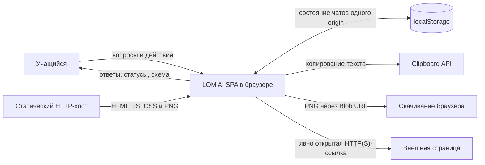
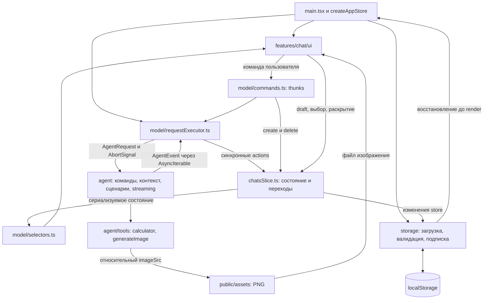
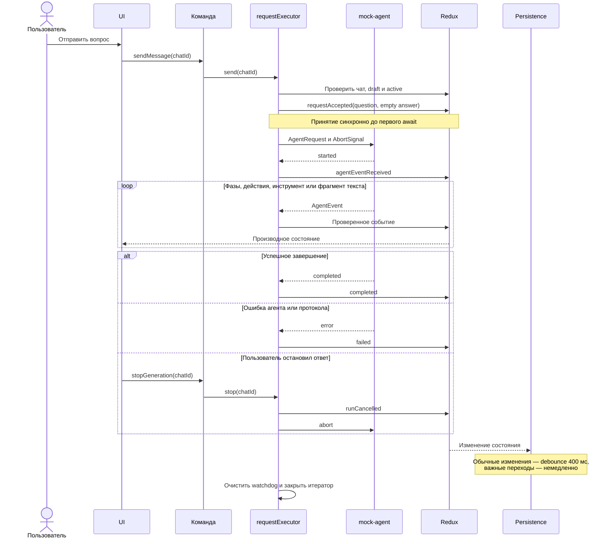
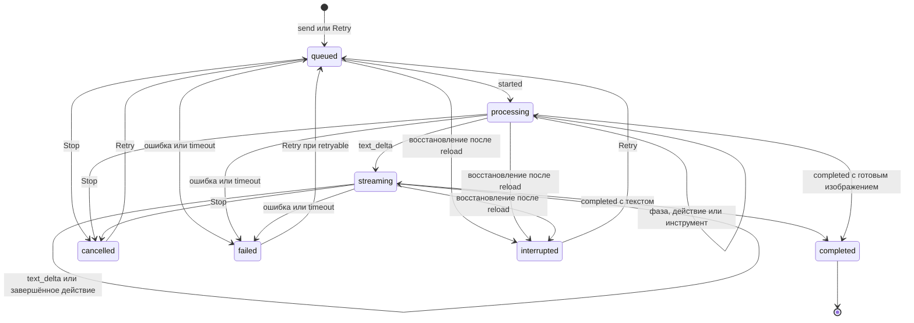

# LOM AI — Architecture

Документ описывает архитектуру реализованного LOM AI; наблюдаемое поведение и критерии качества определены в [Requirements.md](Requirements.md), запуск, конфигурация и команды проверок — в [README](../README.md).

## Context and Scope

### Назначение и граница системы

LOM AI — клиентское SPA для демонстрации учебного диалога на русском языке для учащихся 7–11 классов: объяснение второго закона Ньютона, пошаговое решение одного фиксированного уравнения и умножение целых чисел. Ответы подготовлены заранее, агент и инструменты работают в браузере. Пользователь работает с независимыми чатами, потоковыми ответами, подсказками, Stop/Retry и готовой схемой; соответствующие обязательства находятся в [Functional Requirements](Requirements.md#functional-requirements).

Вся предметная логика, агент и инструменты выполняются в браузере. Термин «генератор изображения» обозначает mock-инструмент, который после задержки возвращает путь к предоставленному PNG, а не внешний сервис генерации. Текстовые ответы подготовлены заранее, команды распознаются по явной грамматике.

Статический хост доставляет ресурсы и не исполняет учебную логику. Внешняя страница открывается только через ссылку пользователя; ответ агента не делает запрос к внешнему AI API. Clipboard API и скачивание — браузерные интеграции, которые могут завершиться отказом.

### Объём и ограничения

В границу решения входят UI, Redux-модель чатов, исполнитель запросов, mock-agent, локальные инструменты, слой сохранения и статические ресурсы. Backend, LLM, аккаунты, серверная синхронизация и сетевой streaming-протокол отсутствуют. Между вкладками нет синхронизации, каждый экземпляр приложения держит собственное состояние в памяти.

Приложение собирается Vite в `dist/`. В [vite.config.ts](../vite.config.ts) базовый путь выбирается по команде: `/` для dev-сервера и `/study-chat/` для production-сборки и preview. JS, CSS и локальный PNG разрешаются с учётом этой базы, изображение использует `import.meta.env.BASE_URL`. Workflow [deploy.yml](../.github/workflows/deploy.yml) собирает проект после push в `master` и передаёт в GitHub Pages только содержимое `dist`. Адрес демо указан в [README](../README.md); локальная проверка сборки не подтверждает успешный запуск workflow на GitHub.

Поддержанный объём проверки — Chrome и DevTools; другие браузеры и физические мобильные устройства остаются за пределами подтверждённой приёмки.

## Building Blocks

### Компоненты и зависимости

Стрелка `generateImage → PNG` обозначает выбор ресурса по теме: сам mock-инструмент не загружает файл. Загрузка выполняется `img` в UI либо `fetch` при скачивании. Общие зависимости — `shared` с иконками и отменяемой задержкой; они не зависят от feature-модулей.

| Блок               | Реализация                                                                                                                                                                                                                                                                                                                     | Ответственность                                                                                                              |
| ------------------ | ------------------------------------------------------------------------------------------------------------------------------------------------------------------------------------------------------------------------------------------------------------------------------------------------------------------------------ | ---------------------------------------------------------------------------------------------------------------------------- |
| Инициализация      | [main.tsx](../src/main.tsx), [store.ts](../src/app/store.ts), [App.tsx](../src/app/App.tsx)                                                                                                                                                                                                                                    | Создать store до render, восстановить данные, подключить Provider, подписку хранения и disposal при HMR.                     |
| Команды            | [commands.ts](../src/features/chat/model/commands.ts)                                                                                                                                                                                                                                                                          | Отправить, повторить, остановить, создать и удалить чат; проверить актуальность подсказки.                                   |
| Предметная модель  | [types.ts](../src/features/chat/model/types.ts), [chatsSlice.ts](../src/features/chat/model/chatsSlice.ts)                                                                                                                                                                                                                     | Хранить сериализуемое состояние, применять допустимые события, проверять переходы и принадлежность запуска.                  |
| Исполнение         | [requestExecutor.ts](../src/features/chat/model/requestExecutor.ts)                                                                                                                                                                                                                                                            | Принять запрос, снять snapshot истории, создать runtime-handle, читать события, управлять отменой, watchdog и cleanup.       |
| Производные данные | [selectors.ts](../src/features/chat/model/selectors.ts), [helpers.ts](../src/features/chat/model/helpers.ts)                                                                                                                                                                                                                   | Вывести доступность send/retry, статусы, метаданные строк, успешную историю и актуальные подсказки.                          |
| Mock-agent         | [mockAgent.ts](../src/agent/mockAgent.ts), [commands.ts](../src/agent/commands.ts), [context.ts](../src/agent/context.ts), [scenarios.ts](../src/agent/scenarios.ts), [suggestions.ts](../src/agent/suggestions.ts), [streaming.ts](../src/agent/streaming.ts)                                                                 | Распознать запрос, восстановить учебный контекст, выбрать подготовленный сценарий и выдать события с задержками.             |
| Инструменты        | [calculator.ts](../src/agent/tools/calculator.ts), [generateImage.ts](../src/agent/tools/generateImage.ts)                                                                                                                                                                                                                     | Проверить ограниченное умножение или вернуть локальный PNG; не зависеть от UI и Redux.                                       |
| Хранение           | [chatStorage.ts](../src/storage/chatStorage.ts), [validation.ts](../src/storage/validation.ts), [persistence.ts](../src/storage/persistence.ts)                                                                                                                                                                                | Прочитать и проверить JSON, восстановить interrupted, сохранять изменения с debounce и немедленной записью важных переходов. |
| Оболочка           | [ChatWorkspace.tsx](../src/features/chat/ui/ChatWorkspace.tsx), [Sidebar.tsx](../src/features/chat/ui/Sidebar.tsx), [ChatDialog.tsx](../src/features/chat/ui/ChatDialog.tsx)                                                                                                                                                   | Навигация, выбор, создание, подтверждение удаления, справка, режимы панели и фокус.                                          |
| Диалог             | [Composer.tsx](../src/features/chat/ui/Composer.tsx), [MessageList.tsx](../src/features/chat/ui/MessageList.tsx), [MessageItem.tsx](../src/features/chat/ui/MessageItem.tsx), [SuggestedReplies.tsx](../src/features/chat/ui/SuggestedReplies.tsx), [ExecutionStatus.tsx](../src/features/chat/ui/ExecutionStatus.tsx)         | Ввод, сообщения, позиции чтения, подсказки, статусы и история действий.                                                      |
| Представление      | [MarkdownContent.tsx](../src/features/chat/ui/MarkdownContent.tsx), [contentPolicy.ts](../src/features/chat/ui/contentPolicy.ts), [CopyResponse.tsx](../src/features/chat/ui/CopyResponse.tsx)                                                                                                                                 | Безопасный Markdown, разрешённые URL, копирование исходного текста и локальные ошибки операции.                              |
| Изображения        | [MessageImage.tsx](../src/features/chat/ui/MessageImage.tsx), [imageAnimation.ts](../src/features/chat/ui/imageAnimation.ts), [ImageViewer.tsx](../src/features/chat/ui/ImageViewer.tsx), [useImageDownload.ts](../src/features/chat/ui/useImageDownload.ts), [responseActions.ts](../src/features/chat/ui/responseActions.ts) | Загрузка и анимация, просмотр, скачивание исходного Blob, освобождение ресурсов.                                             |

Названия завершённых действий и форматирование длительности вынесены в [execution.ts](../src/features/chat/model/execution.ts); переходы run обрабатываются в chatsSlice.

### Технологии

Версии приведены по [package.json](../package.json), точное дерево зависимостей закреплено в `package-lock.json`.

| Область   | Технологии                                                    | Применение                                                      |
| --------- | ------------------------------------------------------------- | --------------------------------------------------------------- |
| UI        | React 19.3.1, React DOM 19.3.1                                | Компоненты, локальные hooks, memo и нативные элементы браузера. |
| Типизация | TypeScript 6.0.3, strict                                      | Контракты сообщений, событий, фаз и внедряемых зависимостей.    |
| Состояние | Redux Toolkit 2.14.0, React Redux 9.3.1                       | Store, reducers, thunks, подписки и селекторы.                  |
| Сборка    | Vite 8.3.6                                                    | Dev-сервер и статическая production-сборка.                     |
| Стили     | CSS Modules, CSS variables                                    | Локальные классы, общие токены, медиазапросы и reduced motion.  |
| Markdown  | react-markdown 10.1.0                                         | Отрисовка подготовленных ответов с отключённым raw HTML.        |
| Проверки  | Vitest 5.1.0, Playwright 1.64.1, ESLint, Prettier, TypeScript | Unit, четыре integration, один E2E, статические проверки.       |

Node.js и npm, порты и команды запуска описаны в [конфигурации README](../README.md#конфигурация). Проект не использует router, RTK Query, отдельную библиотеку автоматов состояний или сетевой API.

### Владение состоянием и данные

| Владелец                      | Содержимое                                                                                                             | Срок жизни                                                        |
| ----------------------------- | ---------------------------------------------------------------------------------------------------------------------- | ----------------------------------------------------------------- |
| Redux `chats`                 | `byId`, `order`, `selectedChatId`; сообщения, draft, `unreadRunId`, `demonstratedFailures`.                            | Сессия с восстановлением из JSON.                                 |
| Ответ ассистента              | `replyToMessageId`, `text`, `imageSrc`, необязательный `imageAlt`, `run`.                                              | Сохраняется вместе с чатом.                                       |
| `run`                         | ID, attempt, acceptedAt, status/phase, completed actions, expanded; finishedAt и ошибка для соответствующих состояний. | Одна попытка ответа; Retry создаёт новый run в прежнем сообщении. |
| Redux `app`                   | Статус доступности хранилища и уведомление.                                                                            | Текущая сессия; не часть сохранённого chat JSON.                  |
| Один requestExecutor на store | `Map<runId, RunHandle>` с AbortController, watchdog и задачей.                                                         | Только runtime; не сериализуется.                                 |
| Подписка хранения             | Таймер debounce и признак разрешённой записи.                                                                          | До disposal или первой ошибки записи.                             |
| React state/ref               | Меню, свёрнутая панель, цель удаления, focus, анимация, состояние копирования/скачивания и позиции чтения.             | UI-сессия; не сохраняется в localStorage.                         |

Позиции чтения хранятся в `Map<ChatId, ScrollState>` у ChatWorkspace. MessageList сохраняет `scrollTop` и `followBottom`, восстанавливает их после DOM через layout effect и использует один ResizeObserver основного контейнера. Следование включено при расстоянии до конца не более 80 px; пользовательское чтение выше порога не сдвигается streaming-обновлениями. Плавная прокрутка применяется только по кнопке перехода вниз; при reduced motion она мгновенная. Удаление чата убирает его позицию из Map.

Учебный контекст и подсказки вычисляются из успешной истории, а не сохраняются отдельными полями. `demonstratedFailures` — сохранённые отметки уже показанных демонстрационных ошибок; они не являются учебным прогрессом. `expanded` — осознанное исключение из локального UI-состояния: раскрытие истории ответа должно переживать reload.

### Контракт агента

[Agent](../src/agent/types.ts) принимает `AgentRequest` и `AbortSignal`, возвращая `AsyncIterable<AgentEvent>`. Snapshot запроса содержит `chatId`, `assistantMessageId`, `runId`, `attempt`, текущий `prompt`, только completed-пары предыдущей истории и копию отметок демонстрационных сбоев.

| Событие                     | Значение                                                             |
| --------------------------- | -------------------------------------------------------------------- |
| `started`                   | Выход из очереди в обработку.                                        |
| `phase_changed`             | Фаза анализа или формирования текста.                                |
| `action_completed`          | Завершённое высокоуровневое действие с отдельным actionId.           |
| `tool_call` / `tool_result` | Согласованная пара по callId и tool с проверяемым payload.           |
| `text_delta`                | Следующий текстовый фрагмент.                                        |
| `completed`                 | Успешное завершение с непустым текстом либо допустимым изображением. |
| `error`                     | Нормализованная ошибка с признаком возможности повтора.              |

Каждое событие адресовано тройкой `chatId / assistantMessageId / runId` и временем `at`. Executor отбрасывает чужую адресацию; reducer дополнительно проверяет текущий run, допустимость перехода, инструмент, callId и данные. Ошибка протокола нормализуется как `protocol_error`; необработанное исключение агента — как `unknown`, ранний конец итератора — как `unexpected_end`, watchdog — как `timeout`. Технические Error и stack trace не сохраняются и не показываются пользователю.

### Прохождение запроса

Диаграмма показывает общий путь; подписка Persistence получает каждое изменение store, включая старт и промежуточные дельты, а не только последнее уведомление на схеме. Ошибка, исключение или отмена освобождают только свой handle; старый cleanup не удаляет runtime другой попытки.

При send snapshot истории фиксируется один раз. При нажатии подсказки thunk проверяет её наличие в актуальном наборе, executor — ожидаемый ID последнего completed-ответа; draft сохраняется. При обычной отправке draft очищается синхронно с добавлением пары. Повторная отправка во время active отклоняется.

Stop сначала переводит данные в `cancelled`, затем отменяет работу. Retry сохраняет ID вопроса и ответа, создаёт новый `runId`, увеличивает attempt и очищает результат/actions/expanded. Delete останавливает только свой запуск и одним действием удаляет чат с выбором соседа или созданием нового. Switch не отменяет agent и снимает непрочитанную отметку своего чата.

### Жизненный цикл запуска

Стрелки Retry обозначают новую попытку с новым runId в том же сообщении; терминальный run не возобновляется. `interrupted` создаётся при загрузке сохранённых данных, а не событием агента. Поздние события не изменяют ни один терминальный результат.

### Сохранение и восстановление

[loadChats](../src/storage/chatStorage.ts) читает один ключ `lom-ai:chat`, разбирает JSON и проверяет структуру через [isChatsState](../src/storage/validation.ts). Проверка включает принадлежность сообщений, допустимые run-состояния, actions, image-пути и связанные инварианты. Отсутствующая запись создаёт исходный пустой чат; повреждённая или недоступная отключает запись на сессию.

Перед первым render активные run переводятся в `interrupted` с сохранением последнего записанного текста, изображения и завершённых действий. Агент автоматически не запускается. Восстановленное состояние записывается только при необходимости; валидные терминальные данные не переписываются на старте.

[persistence](../src/storage/persistence.ts) подписывается один раз: обычные изменения сохраняются через 400 мс после последнего изменения; создание/удаление, терминальные переходы, отметки сбоев, непрочитанного и раскрытие истории фиксируются немедленно согласно проверкам `needsImmediateSave`. Ошибка записи отключает дальнейшие попытки на сессию и переводит UI к работе в памяти с уведомлением.

JSON содержит пути к изображениям, а не Blob или base64. Незаписанные из-за debounce последние изменения могут потеряться при внезапном закрытии вкладки; гарантируется восстановление сохранённого snapshot, а не каждой ещё не записанной дельты. Миграционный слой с версиями схемы отсутствует; поддержаны только явно принимаемые validator поля и прежние варианты данных.

### Представление и браузерные действия

MarkdownContent использует `react-markdown` с `skipHtml`, исключёнными `img` и фильтром URL. Разрешены только абсолютные HTTP(S)-ссылки, открываемые с `noopener noreferrer`; изображения выводятся отдельным компонентом из разрешённых путей `assets/` с учётом базы публикации.

Копирование передаёт в Clipboard API исходный текст целиком; ошибка отображается в строке статуса. Скачивание загружает исходный PNG, проверяет ответ и Blob, создаёт временный URL и ссылку с именем `lom-ai-newton.png`; URL и DOM-элемент освобождаются при завершении, исключении или отмене.

Проявление схемы реализовано локальным reducer `imageAnimation.ts`: blur → particles → fading → revealing → ready. Ранний load не пропускает частицы, поздний load удерживает проявление до готовности файла. Завершение agent-запроса не ждёт CSS-анимацию. Возврат к фоновому результату, reload и reduced motion приводят к статичному показу после загрузки; ошибка файла имеет отдельное UI-состояние.

Визуальные размеры, цвета, типографика и состояния заданы в [styles.css](../src/app/styles.css) и [ChatWorkspace.module.css](../src/features/chat/ui/ChatWorkspace.module.css); размеры интерфейса не дублируются в требованиях как отдельные обязательства.

## Architecture Decisions

Обоснования ниже восстановлены из существовавших технических требований и реализованных границ модулей; это документирование принятых решений, а не новый сравнительный эксперимент.

| ID    | Решение и причина                                                                                                                         | Последствия и ограничения                                                                                                             | Связанные требования                                                                                                                                                     |
| ----- | ----------------------------------------------------------------------------------------------------------------------------------------- | ------------------------------------------------------------------------------------------------------------------------------------- | ------------------------------------------------------------------------------------------------------------------------------------------------------------------------ |
| AD-01 | React + TypeScript + Vite для клиентского SPA с типизированными контрактами и статической сборкой.                                        | Серверный runtime не нужен; данные доступны только в браузерной сессии и локальном хранилище.                                         | [FR-001](Requirements.md#fr-001), [FR-036](Requirements.md#fr-036), [QR-027](Requirements.md#qr-027)                                                                     |
| AD-02 | Redux хранит предметные данные, React — временное UI-состояние; расширение истории ответа сохраняется в run по требованию восстановления. | Store остаётся сериализуемым, локальная прокрутка и runtime не попадают в JSON; expanded переживает reload.                           | [FR-048](Requirements.md#fr-048), [FR-050](Requirements.md#fr-050), [QR-011](Requirements.md#qr-011)                                                                     |
| AD-03 | Один executor на store и тонкие thunks концентрируют асинхронность вне reducers.                                                          | Явные адресация, AbortController, watchdog и disposal; reducer выполняет только синхронные проверки и переходы.                       | [FR-016](Requirements.md#fr-016), [FR-019](Requirements.md#fr-019), [QR-001](Requirements.md#qr-001), [QR-005](Requirements.md#qr-005)                                   |
| AD-04 | AsyncIterable и AbortSignal задают контракт агента без сетевого streaming-протокола.                                                      | Управляемая событийная модель тестируется с внедрённым agent; реальное AI-подключение потребует отдельного адаптера и не реализовано. | [FR-018](Requirements.md#fr-018), [QR-003](Requirements.md#qr-003), [QR-004](Requirements.md#qr-004)                                                                     |
| AD-05 | Учебный контекст выводится из completed-пар пользовательской истории; команды имеют явную грамматику.                                     | Fallback и ошибки не продвигают обучение; произвольные формулировки и другие уравнения не решаются.                                   | [FR-025](Requirements.md#fr-025), [FR-028](Requirements.md#fr-028), [FR-029](Requirements.md#fr-029), [FR-030](Requirements.md#fr-030)                                   |
| AD-06 | Новый runId при Retry сохраняет исходную пару сообщений и отделяет попытки.                                                               | Поздние события и cleanup прошлой попытки не изменяют новую; повтор успешного ответа не поддержан.                                    | [FR-020](Requirements.md#fr-020), [FR-021](Requirements.md#fr-021), [QR-002](Requirements.md#qr-002)                                                                     |
| AD-07 | Один JSON в localStorage, runtime-валидация и простая подписка с debounce соответствуют локальному демонстрационному объёму.              | Нужна обработка запретов и повреждения; нет серверного backup, синхронизации вкладок и гарантии записи каждой дельты.                 | [FR-036](Requirements.md#fr-036), [FR-038](Requirements.md#fr-038), [QR-006](Requirements.md#qr-006), [QR-012](Requirements.md#qr-012), [QR-013](Requirements.md#qr-013) |
| AD-08 | Готовый PNG и локальный mock-инструмент обеспечивают воспроизводимую демонстрацию схемы.                                                  | Изображение ограничено темой Ньютона; анимация и скачивание независимы от завершения agent-запроса.                                   | [FR-043](Requirements.md#fr-043), [FR-045](Requirements.md#fr-045), [QR-010](Requirements.md#qr-010)                                                                     |
| AD-09 | CSS Modules, общие CSS variables и нативный dialog поддерживают локальные стили, адаптивность и стандартное управление фокусом.           | UI hooks отвечают за переходы режимов, закрытие и возврат фокуса; качество требует ручных браузерных проверок.                        | [FR-053](Requirements.md#fr-053), [FR-054](Requirements.md#fr-054), [QR-017](Requirements.md#qr-017), [QR-018](Requirements.md#qr-018), [QR-021](Requirements.md#qr-021) |
| AD-10 | Безопасный Markdown, allowlist URL и отдельный компонент изображения ограничивают исполняемое содержимое сообщений.                       | Нет raw HTML, произвольных URL изображения и встроенных Markdown-картинок; HTTP(S)-ссылки пользователь открывает отдельно.            | [FR-039](Requirements.md#fr-039), [QR-014](Requirements.md#qr-014), [QR-015](Requirements.md#qr-015), [QR-016](Requirements.md#qr-016)                                   |
| AD-11 | Внедрение agent/clock/ID/random и fake timers позволяют проверять гонки и границы задержек без случайных ожиданий.                        | Модельные временные проверки не заменяют измерения wall-clock времени на физическом устройстве.                                       | [QR-008](Requirements.md#qr-008), [QR-009](Requirements.md#qr-009), [QR-025](Requirements.md#qr-025)                                                                     |

## Quality Considerations

Таблица связывает критерий с механизмом и его пределом; определения QR и конкретные тесты находятся в [Requirements.md](Requirements.md#покрытие-quality-requirements).

| Требования                                                                                           | Как обеспечивает архитектура                                                                                                     | Проверка и практический предел                                                                                             |
| ---------------------------------------------------------------------------------------------------- | -------------------------------------------------------------------------------------------------------------------------------- | -------------------------------------------------------------------------------------------------------------------------- |
| [QR-001](Requirements.md#qr-001), [QR-002](Requirements.md#qr-002)                                   | Адресация событий и guards в executor/reducer, терминальная блокировка, новый runId на Retry.                                    | Unit гонок и INT-02/INT-03/INT-04; выбор чата не является владельцем agent-запроса.                                        |
| [QR-003](Requirements.md#qr-003), [QR-004](Requirements.md#qr-004), [QR-005](Requirements.md#qr-005) | Watchdog с default 30 000 мс, чтение с abort, нормализация ошибок, неблокирующее закрытие итератора, собственный cleanup handle. | Тесты используют сокращённые управляемые задержки; штатный default находится в helpers.ts.                                 |
| [QR-006](Requirements.md#qr-006), [QR-012](Requirements.md#qr-012), [QR-013](Requirements.md#qr-013) | Валидация до render, отключение записи при повреждении/ошибке, debounce и немедленные важные записи.                             | Store/storage-тесты и ручные отказы; память не заменяет постоянное хранение после закрытия страницы.                       |
| [QR-007](Requirements.md#qr-007)                                                                     | Разбиение streaming по Unicode code points и точное сохранение исходных блоков Markdown.                                         | Проверяются Unicode, CRLF, код и частичная разметка; это не универсальный инкрементальный Markdown-парсер.                 |
| [QR-008](Requirements.md#qr-008), [QR-009](Requirements.md#qr-009), [QR-010](Requirements.md#qr-010) | Отдельные диапазоны операций, скорость текста и размеры фрагментов в [config.ts](../src/agent/config.ts); паузы не дублируются.  | Fake timers и контролируемый random; таймеры фоновой вкладки могут замедляться браузером.                                  |
| [QR-011](Requirements.md#qr-011)                                                                     | Мемоизированные селекторы подсказок и метаданных, неизменяемые ссылки на незатронутые части состояния, memo компонентов.         | Проверки идентичности отдельных результатов не доказывают полный профиль render или конкретный FPS.                        |
| [QR-014](Requirements.md#qr-014), [QR-015](Requirements.md#qr-015), [QR-016](Requirements.md#qr-016) | Allowlist HTTP(S), проверка assets-путей, skipHtml и отдельный вывод изображения.                                                | Политики URL проверены unit, поведение представления — ручной матрицей; полноценного security-аудита нет.                  |
| [QR-017](Requirements.md#qr-017), [QR-018](Requirements.md#qr-018)                                   | Нативные button/textarea/dialog, доступные имена и aria-связи, управление начальным и возвращаемым фокусом.                      | Клавиатура и фокус проверяются вручную; Node-тесты не заменяют DOM-проверку.                                               |
| [QR-019](Requirements.md#qr-019), [QR-020](Requirements.md#qr-020)                                   | Общие цветовые токены, явные стили текста, границ, иконок и focus.                                                               | Существует ручной сценарий измерения; численный протокол контраста в проекте не сохранён, полный аудит WCAG не заявляется. |
| [QR-021](Requirements.md#qr-021), [QR-022](Requirements.md#qr-022)                                   | Медиазапросы 768/1024 px, мобильный drawer, гибкая история, ограничение высоты composer, локальные scroll-контейнеры.            | Chrome/DevTools, 200% zoom и малая высота; физическая клавиатура и safe area не проверены.                                 |
| [QR-023](Requirements.md#qr-023)                                                                     | prefers-reduced-motion в CSS/JS, skip в reducer анимации, мгновенный переход истории.                                            | Unit проверяет image state; отключение остальных эффектов подтверждается ручным сценарием.                                 |
| [QR-024](Requirements.md#qr-024)                                                                     | Фиксированные учебные тексты и поэтапный выбор сценария, отдельные ответы на уточнения.                                          | Unit проверяет вычисления и отсутствие раннего ответа; произвольные учебные задачи вне объёма.                             |
| [QR-025](Requirements.md#qr-025)                                                                     | Внедряемые clock, ID factory, agent и random; чистые функции контекста/сценариев.                                                | Детерминированность относится к одинаковым входам и конфигурации, а не к неизменности реального времени.                   |
| [QR-026](Requirements.md#qr-026), [QR-027](Requirements.md#qr-027)                                   | Отмена скачивания, освобождение object URL/ссылки и разрешение asset через BASE_URL.                                             | Unit проверяет ресурсы и базовые пути; существующий E2E не подтверждает внешнее развёртывание.                             |

Автоматизация состоит из unit-тестов Vitest, четырёх integration-сценариев модели и одного Playwright E2E: Ньютон → ошибка схемы → Retry → упрощение → reload. Имена и файлы приведены в таблицах [FR](Requirements.md#покрытие-functional-requirements) и [QR](Requirements.md#покрытие-quality-requirements); ручные сценарии сохранены в [каталоге](Requirements.md#каталог-ручных-сценариев). Команды находятся в [запуске проекта](../README.md#запуск-проекта), среда проверок — в [разделе тестирования](../README.md#проверки-и-тестирование).
