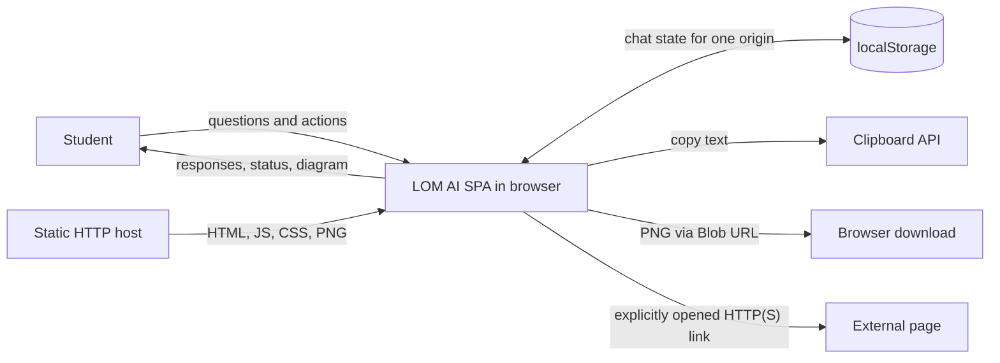
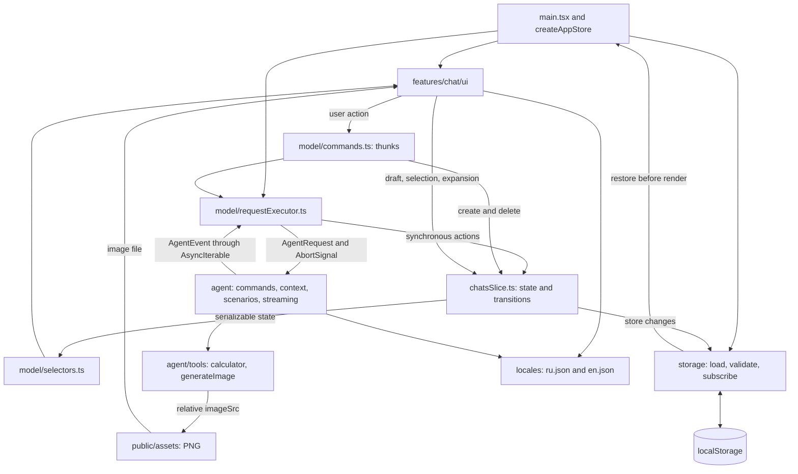
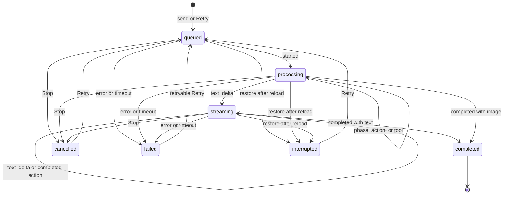

# LOM AI — Architecture

English | [Русский](Architecture.ru.md)

This document describes the implemented LOM AI architecture. Observable behavior and quality criteria are defined in [Requirements](Requirements.md); setup, configuration, and check commands are in the [README](../README.md).

## Context and scope

### Purpose and system boundary

LOM AI is a client-side SPA for demonstrating a learning conversation for students in grades 7–11. It supports explanations of Newton's second law, a step-by-step solution to one fixed equation, and basic integer arithmetic. The interface, prepared scenarios, and responses are available in Russian and English. Answers are prepared in advance; the agent and tools run in the browser.

Users can work with independent chats, streamed responses, suggestions, Stop/Retry, and a supplied diagram. The language switch is in the chat header and the selected language is stored separately from chat history.

The term “image generator” refers to a mock tool that waits and returns a path to the supplied PNG; it is not an external generation service. Text responses are prepared in advance, and commands are recognized with an explicit grammar.



The static host serves assets and does not run learning logic. An external page opens only when the user follows a link; agent responses do not call an external AI API. Clipboard and download are browser integrations and can fail.

### Scope and limitations

The solution includes the UI, Redux chat model, request executor, mock agent, local tools, persistence layer, localization dictionaries, and static assets. There is no backend, LLM connection, account system, server-side sync, or network streaming protocol. Chats are not synchronized between tabs; each app instance keeps its own in-memory state.

Vite builds the app into `dist/`. In [vite.config.ts](../vite.config.ts), the base path is `/` for development and `/study-chat/` for production builds and preview. JS, CSS, and the local PNG resolve against that base path; the image uses `import.meta.env.BASE_URL`. The [deploy workflow](../.github/workflows/deploy.yml) builds on pushes to `master` and publishes only `dist` to GitHub Pages. A local build does not confirm that the GitHub workflow has deployed successfully.

The verified acceptance environment is Chrome and DevTools. Other browsers and physical mobile devices have not been verified.

## Building blocks

### Components and dependencies



The `generateImage → PNG` edge means the mock tool selects an asset by topic; it does not load the file. The UI loads it through `img`, or through `fetch` when downloading. Shared utilities such as icons and abortable delay do not depend on feature modules.

| Block | Implementation | Responsibility and interaction |
| --- | --- | --- |
| Bootstrap | [main.tsx](../src/main.tsx), [store.ts](../src/app/store.ts), [App.tsx](../src/app/App.tsx) | Create Redux before rendering, restore chats, connect Provider and persistence, and dispose old tasks during HMR. `main.tsx` mounts the React app; `store.ts` assembles reducers, executor, agent, and persistence. |
| Commands | [commands.ts](../src/features/chat/model/commands.ts) | Send, retry, stop, create, and delete chats; validate current suggestions. Thunks connect UI intent to application logic. `sendMessage` checks a suggestion and delegates execution; it does not consume the response stream. |
| Domain model | [types.ts](../src/features/chat/model/types.ts), [chatsSlice.ts](../src/features/chat/model/chatsSlice.ts) | Hold serializable state and accept only valid events and run transitions. Reducers add a text fragment only when it belongs to the current run and is valid in the current phase. |
| Execution | [requestExecutor.ts](../src/features/chat/model/requestExecutor.ts) | Validate requests, snapshot history, create runtime handles, consume events, manage cancellation, timeout, and cleanup. Handles contain an AbortController, timer, and task; they stay outside Redux and JSON. |
| Derived data | [selectors.ts](../src/features/chat/model/selectors.ts), [helpers.ts](../src/features/chat/model/helpers.ts) | Calculate send/retry eligibility, statuses, row metadata, successful history, and current suggestions. Helpers centralize shared operations without changing state or starting the agent. |
| Mock agent | [mockAgent.ts](../src/agent/mockAgent.ts), [commands.ts](../src/agent/commands.ts), [context.ts](../src/agent/context.ts), [scenarios.ts](../src/agent/scenarios.ts), [suggestions.ts](../src/agent/suggestions.ts), [streaming.ts](../src/agent/streaming.ts) | Parse a request, derive learning context, select a prepared scenario in the selected language, and emit events. Separate modules isolate parsing, context, response text, streaming, and suggestions. |
| Tools | [calculator.ts](../src/agent/tools/calculator.ts), [generateImage.ts](../src/agent/tools/generateImage.ts) | Run integer arithmetic or return the local PNG path. The agent calls tools through `tool_call`/`tool_result`; the calculator validates its operands again. |
| Persistence | [chatStorage.ts](../src/storage/chatStorage.ts), [validation.ts](../src/storage/validation.ts), [persistence.ts](../src/storage/persistence.ts) | Read and validate JSON, restore interrupted runs, and persist changes. Frequent updates are debounced; important transitions are saved immediately. |
| Localization | [ru.json](../src/locales/ru.json), [en.json](../src/locales/en.json), [languagePreference.ts](../src/app/languagePreference.ts) | Keep UI labels, prompts, suggestions, statuses, and prepared response text in language dictionaries. The selected language is stored under `lom-ai:language`, separately from chats. |

### Technology

Exact versions are pinned in [package.json](../package.json) and [package-lock.json](../package-lock.json).

| Area | Technology | Use |
| --- | --- | --- |
| UI | React 19.3.1, React DOM 19.3.1 | Components, local hooks, memoization, and native browser elements. |
| Types | TypeScript 6.0.3, strict mode | Message, event, phase, and dependency contracts. |
| State | Redux Toolkit 2.14.0, React Redux 9.3.1 | Store, reducers, thunks, subscriptions, and selectors. |
| Build | Vite 8.3.6 | Development server and static production build. |
| Styling | CSS Modules, CSS variables | Local classes, shared tokens, media queries, and reduced motion. |
| Markdown | react-markdown 10.1.0 | Render prepared responses with raw HTML disabled. |
| Checks | Vitest 5.1.0, Playwright 1.64.1, ESLint, Prettier, TypeScript | Unit and integration tests, one E2E flow, and static checks. |

Node.js, npm, ports, and run commands are listed in the [README configuration](../README.md#configuration). The project does not use a router, RTK Query, a state-machine library, or a network API.

### State ownership and data

| Owner | Contents | Lifetime and persistence | Plain-language explanation |
| --- | --- | --- | --- |
| Redux `chats` | `byId`, list `order`, `selectedChatId`, drafts, messages, `unreadRunId`, and `demonstratedFailures`. | Lives while the app is open; serialized to JSON and restored from `localStorage`. | The shared conversation model for the sidebar, message view, and composer. Each chat owns its draft. `unreadRunId` marks a background reply; `demonstratedFailures` records which demo failures have appeared. |
| Assistant message | `replyToMessageId`, `text`, local `imageSrc`, optional `imageAlt`, and `run`. | Saved with chat history; text can be written as fragments arrive. | The response stays next to the question it answers. `imageSrc` is a path, not bitmap data. |
| `run` in a response | Run ID, attempt, start time, status, phase, completed actions, optional finish time/error, and `expanded`. | One response attempt. Retry creates a new run ID in the same message; serializable fields are saved with the chat. | Distinguishes queued, processing, streaming, success, failure, cancellation, and interruption. It is model data, not a live task. `expanded` is persisted so the action history stays open after reload. |
| Derived history, context, and suggestions | `buildAgentHistory`, `deriveContext`, and selectors. | Computed from saved history when needed; not separately persisted. | Learning progress can be reconstructed from completed message pairs, avoiding a duplicate value that could drift out of sync. Partial or cancelled replies do not advance the lesson. |
| Redux `app` | Storage availability and the selected interface language. | Current session state; neither is part of chat JSON. The language preference is separately stored under `lom-ai:language`. | App-shell state, separate from conversation content. |
| One `requestExecutor` per store | `Map<runId, RunHandle>` with AbortController, watchdog timer, and active task Promise. | Runtime only; not serialized. | Tools for controlling the request. Browser objects and executing tasks cannot be restored from JSON. |
| `AgentRequest` snapshot | Chat/message/run IDs, prompt, attempt, completed history, demonstrated failures, and optional response language. | Created on send or Retry; used for that run only. | Fixes the agent input at request start, so later draft edits or chat switching do not change a running request. |
| Persistence subscription | Previous state, debounce timer, and enabled flag. | While attached; cleared on dispose or write failure. | Watches Redux changes and chooses when to write. Frequent changes wait 400 ms; chat creation/deletion and important run transitions are immediate. |
| React state and refs | Open panel, collapsed sidebar, deletion target, focus, animation, copy/download state, and reading positions. | UI session only; usually not persisted. | Temporary presentation details, not conversation content. |

Reading positions are stored in `Map<ChatId, ScrollState>` in ChatWorkspace. MessageList saves `scrollTop` and `followBottom`, restores them after DOM updates, and uses one ResizeObserver on the main container. Auto-follow stays enabled within 80 px of the bottom. Reading older content is not interrupted by streaming updates. Smooth scrolling is used only for the jump-to-latest action and becomes immediate with reduced motion. Deleting a chat also removes its position.

Learning context and suggestions are derived from successful history. `demonstratedFailures` records which demo failures have been shown; it is not learning progress. Persisting `expanded` is a deliberate exception to local UI state because the action history should remain open after reload.

The language selector changes `app.language`. New prompts, suggestions, and responses use that language. Existing message text remains as originally sent or generated; only generic empty-chat titles are localized when displayed.

### Agent contract

The [Agent](../src/agent/types.ts) receives an `AgentRequest` snapshot for one run and an `AbortSignal`. The optional language field selects the response dictionary; requests without it use Russian for backward compatibility.

The agent returns `AsyncIterable<AgentEvent>`, an asynchronous stream. It can report startup, call a tool, and emit text fragments instead of returning one complete string. The executor reads the stream and dispatches each relevant event to Redux; reducers verify whether it is valid for the current chat state.

| Event | Meaning | Plain-language explanation |
| --- | --- | --- |
| `started` | Leave queue and begin processing. | The agent has started the request. |
| `phase_changed` | Analysis or composing phase. | Tells the UI whether the agent is analyzing or preparing a response. |
| `action_completed` | Completed high-level action with an `actionId`. | Adds a step such as request analysis or response preparation to the execution history. |
| `tool_call` / `tool_result` | Matched pair by `callId` and tool, with validated payloads. | The agent requests a tool and receives the result for that same call. |
| `text_delta` | Next response fragment. | The reducer appends it to the message so the UI can show text gradually. |
| `completed` | Successful completion with non-empty text or an allowed image. | No further events are expected. Empty text without an image is not success. |
| `error` | Normalized error with retryability. | The UI shows a useful message instead of a stack trace and can offer Retry when allowed. |

Every event includes `chatId`, `assistantMessageId`, `runId`, and timestamp `at`. The executor rejects events addressed elsewhere; the reducer checks run freshness, transition order, and tool data. Protocol violations become `protocol_error`; uncaught exceptions become `unknown`; early stream termination becomes `unexpected_end`; and the watchdog produces `timeout`. Error objects and stack traces are not saved or shown.

### Request flow

```mermaid
sequenceDiagram
    actor U as User
    participant UI as UI
    participant C as Command
    participant E as requestExecutor
    participant A as mock agent
    participant R as Redux
    participant P as Persistence

    U->>UI: Send question
    UI->>C: sendMessage(chatId)
    C->>E: send(chatId)
    E->>R: Validate chat, draft, and active run
    E->>R: requestAccepted(question, empty answer)
    Note over E,R: Acceptance is synchronous before the first await
    E->>A: AgentRequest and AbortSignal
    A-->>E: started
    E->>R: agentEventReceived
    loop Phases, actions, tool use, or text fragment
        A-->>E: AgentEvent
        E->>R: Validated event
        R-->>UI: Derived state
    end
    alt Successful completion
        A-->>E: completed
        E->>R: completed
    else Agent or protocol error
        A-->>E: error
        E->>R: failed
    else User stops response
        UI->>C: stopGeneration(chatId)
        C->>E: stop(chatId)
        E->>R: runCancelled
        E->>A: abort
    end
    R-->>P: State change
    Note over P: Ordinary changes are debounced 400 ms;<br/>important transitions are saved immediately
    E->>E: Clear watchdog and close iterator
```

Persistence sees every store update, including startup and intermediate fragments. Errors, exceptions, and cancellation clean up only their own handle; cleanup from an old run cannot remove another run's resources.

On send, the history snapshot is fixed once. For a suggested reply, the thunk checks that the suggestion is current and the executor verifies the last completed response ID; the draft is preserved. A manual send clears the draft when the message pair is accepted. A second request in the same chat is rejected while a run is active.

Stop first marks the run `cancelled`, then aborts its work. Retry retains the same question/answer message IDs, creates a new `runId`, increments the attempt, and clears the response, actions, and expanded state. Delete stops only that chat's run and atomically removes it, selecting a neighbor or creating a replacement. Switching chats does not stop the original request; opening a chat clears its unread marker.

### Run lifecycle



Retry starts a new run ID in the same message; a terminal run is never resumed. `interrupted` is created while loading saved data, not by an agent event. Late events cannot change a terminal result.

### Persistence and restoration

[loadChats](../src/storage/chatStorage.ts) reads the `lom-ai:chat` key, parses JSON, and validates it with [isChatsState](../src/storage/validation.ts). Validation checks message ownership, run states, actions, image paths, and related invariants. A missing value creates an empty initial chat; corrupted or inaccessible storage disables writes for the session.

Before the first render, active runs become `interrupted`, preserving the last saved text, image, and completed actions. The agent does not restart automatically. Restored state is written only when needed; valid terminal records are not rewritten at startup.

[persistence](../src/storage/persistence.ts) subscribes once. Ordinary changes are written 400 ms after the latest change. Chat creation/deletion, terminal transitions, demonstrated failures, unread markers, and expanded action history are saved immediately by `needsImmediateSave`. A write failure disables later attempts for the session and the UI reports that the app is running in memory.

Chat JSON contains image paths, not Blobs or base64 data. Unsaved changes still waiting in the debounce window can be lost if the tab closes unexpectedly. There is no schema migration layer; only validator-supported fields and known older forms are accepted.

Language preference is stored separately under `lom-ai:language`; failure to save that preference does not disable chat persistence.

### Presentation and browser actions

MarkdownContent uses `react-markdown` with raw HTML and Markdown images disabled, and filters URLs. Only absolute HTTP(S) links are allowed; they open with `noopener noreferrer`. Images are rendered separately from allowed `assets/` paths resolved against the deployment base.

Copy sends the full original response text to the Clipboard API; failures appear in a status message. Download fetches the original PNG, validates the response and Blob, creates a temporary object URL and a link named `lom-ai-newton.png`, then releases both resources on completion, exception, or cancellation.

The diagram reveal uses the local `imageAnimation.ts` reducer: blur → particles → fading → revealing → ready. Early image loading does not skip the particles; late loading delays the reveal until the file is ready. Agent completion does not wait for the CSS animation. Restored or background images and reduced-motion mode show the image statically; file errors have their own UI state.

Visual sizes, colors, typography, and states are defined in [styles.css](../src/app/styles.css) and [ChatWorkspace.module.css](../src/features/chat/ui/ChatWorkspace.module.css); they are not duplicated as separate requirements.

## Architecture decisions

These decisions are documented from the implemented module boundaries and requirements; they are not claims about a new comparative experiment.

| ID | Decision and reason | Consequences and limits |
| --- | --- | --- |
| AD-01 | React, TypeScript, and Vite for a typed client SPA and static build. | No server runtime is needed; data is limited to the browser and local storage. |
| AD-02 | Redux holds domain data; React holds temporary UI state. Expanded execution history is persisted because restoration requires it. | The store stays serializable; scroll state and runtime tasks stay outside JSON. |
| AD-03 | One executor per store and thin thunks keep async work out of reducers. | Explicit addressing, AbortController, watchdog, and disposal; reducers stay synchronous. |
| AD-04 | AsyncIterable and AbortSignal define an agent contract without a network streaming protocol. | The injected agent is testable; a real AI connection would need a separate adapter and is not implemented. |
| AD-05 | Learning context is derived from completed chat history; commands use an explicit grammar. | Fallbacks and failures do not advance learning. Arbitrary phrasing and other equations are unsupported. |
| AD-06 | Retry uses a new run ID while preserving the original message pair. | Late events and old cleanup cannot alter a new run; retrying successful responses is unsupported. |
| AD-07 | One localStorage JSON record, runtime validation, and a debounced subscription fit the local demo. | Storage denial and corruption are handled, but there is no server backup, tab sync, or guarantee for every unsaved fragment. |
| AD-08 | A supplied PNG and local mock tool make the diagram demo reproducible. | Image content is limited to Newton's law; reveal animation and download are independent of agent completion. |
| AD-09 | CSS Modules, shared CSS variables, and native dialog support local styles, responsive UI, and focus behavior. | UI hooks control mode changes, close, and focus restoration; browser checks are still needed. |
| AD-10 | Safe Markdown, URL allowlists, and a separate image component restrict message content. | No raw HTML, arbitrary image URLs, or Markdown images; users explicitly open HTTP(S) links. |
| AD-11 | Injected agent, clock, ID factory, and random source plus fake timers make races and delay limits testable. | Controlled-time tests do not measure wall-clock performance on physical devices. |
| AD-12 | JSON dictionaries localize UI, prompts, suggestions, statuses, and scenario responses. | Only prepared Russian and English content is available; existing message text stays in the language in which it was created. |

## Quality considerations

The table links each quality requirement to its mechanism and practical limit. Definitions and test references are in [Quality Requirements](Requirements.md#quality-requirements).

| Requirements | Architectural support | Check and practical limit |
| --- | --- | --- |
| QR-001, QR-002 | Event addressing and guards in executor/reducer, terminal-state lock, new run ID on Retry. | Unit race checks and INT-02/INT-03/INT-04; a selected chat does not own the agent request. |
| QR-003–QR-005 | 30,000 ms watchdog, abort-aware reading, normalized errors, non-blocking iterator close, per-handle cleanup. | Tests use controlled short delays; the production default is in helpers.ts. |
| QR-006, QR-012, QR-013 | Validate before render, disable writes after corruption/failure, debounce and immediate important writes. | Store/storage tests and manual failure scenarios; memory mode is not persistence after closing the page. |
| QR-007 | Split streaming by Unicode code points and preserve original Markdown blocks. | Tests cover Unicode, CRLF, code, and partial markup; this is not a general incremental Markdown parser. |
| QR-008–QR-010 | Separate ranges for operations, text speed, and fragment sizes in [config.ts](../src/agent/config.ts); pauses are not double-counted. | Fake timers and controlled random; background-tab throttling can delay timers. |
| QR-011 | Memoized suggestion and row-metadata selectors, stable references for unaffected state, memoized components. | Identity tests do not prove full render profiles or a particular FPS. |
| QR-014–QR-016 | HTTP(S) allowlist, asset-path validation, skipHtml, and separate image rendering. | URL policies have unit coverage and manual UI checks; no full security audit is claimed. |
| QR-017–QR-018 | Native buttons, textarea, dialog, accessible names and ARIA relations, focus entry and return. | Keyboard and focus are checked manually; Node tests do not replace DOM checks. |
| QR-019–QR-020 | Shared color tokens and explicit text, border, icon, and focus styles. | A manual measurement scenario exists; no saved numeric contrast report or full WCAG audit is claimed. |
| QR-021–QR-022 | 768/1024 px media queries, mobile drawer, flexible history, bounded composer, local scroll containers. | Chrome/DevTools, 200% zoom, and short viewport checks; physical keyboard and safe area are not verified. |
| QR-023 | prefers-reduced-motion in CSS/JS, animation reducer skip, immediate history navigation. | Unit tests cover image state; other effects require manual confirmation. |
| QR-024 | Fixed learning content, staged scenarios, and separate answers to follow-up questions. | Tests check calculations and no early answer; arbitrary learning tasks are out of scope. |
| QR-025 | Injected clock, ID factory, agent, and random source; pure context/scenario functions. | Determinism means identical inputs and configuration, not a frozen real clock. |
| QR-026–QR-027 | Cancelable download, released object URL/link, assets resolved through BASE_URL. | Unit tests cover resources and base paths; current E2E does not verify external deployment. |

Automation includes Vitest unit tests, four model integration scenarios, and one Playwright E2E: Newton → diagram failure → Retry → simplification → reload. Test names and files are linked from [functional coverage](Requirements.md#coverage-of-functional-requirements) and [quality coverage](Requirements.md#coverage-of-quality-requirements); manual scenarios are in the [catalog](Requirements.md#manual-scenario-catalog). Commands and test environment are in the [README](../README.md#checks-and-testing).